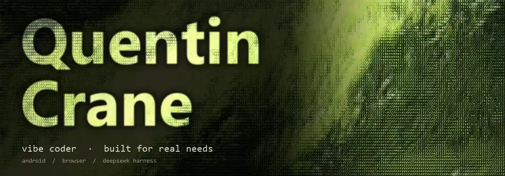

 

 

---

## :wave: Hi there, I'm quentincrane

一个为自己写工具的 **vibe coder**

这里放着的都是我为了解决自身需求做出来的小作品；如果它们刚好也切中了你的痛点，欢迎一起把它们打磨得更好 :sparkles:

---

## :zap: Tech Stack

---

## :fire: Featured Projects

### :electric_plug: DeepSeek Harness 插件

  
  
  

<table>
<tr>
<td width="50%" valign="top">

#### :zap: dsh-combo

> PowerMode 风格的实时连击与特效反馈

- :sparkles: Token 与工具调用实时连击统计
- :fire: 四档动态粒子特效 + 倒计时条
- :art: 多主题配色、合成音效与可视化面板

[:arrow_right: 查看项目](https://github.com/QuentinCrane/dsh-combo)

</td>
<td width="50%" valign="top">

#### :card_index_dividers: dsh-session-sidebar

> Codex 风格的收件箱式会话管理侧边栏

- :inbox_tray: 运行中 / 待处理 / 未读会话分类聚合
- :pushpin: 独立置顶空间 + 工作区内置顶双模式
- :mag: 工作区树视图、拖拽排序与全文搜索

[:arrow_right: 查看项目](https://github.com/QuentinCrane/dsh-session-sidebar)

</td>
</tr>
</table>

### :globe_with_meridians: 浏览器扩展

  
  
  

<table>
<tr>
<td width="50%" valign="top">

#### :tv: BiliTube

> 给 B 站网页版换上 YouTube Desktop 式布局

- :framed_picture: 响应式推荐网格 + 清爽折叠侧栏
- :clapper: 双栏视频详情页 + 卡片悬停预览
- :shield: 保留 B 站原生播放器、弹幕与评论交互

[:arrow_right: 查看项目](https://github.com/QuentinCrane/BiliTube)

</td>
<td width="50%" valign="top">

#### :bookmark_tabs: BookmarkWall

> 把原生书签变成一面可视化海报墙

- :art: 网页截图海报墙 + 拖拽自由排布
- :mag_right: 全文检索、标签筛选与本地备份恢复
- :robot: 可选 AI 智能分类整理建议

[:arrow_right: 查看项目](https://github.com/QuentinCrane/BookmarkWall)

</td>
</tr>
</table>

### :iphone: Android 应用

  
  
  
  

<table>
<tr>
<td width="50%" valign="top">

#### :camera: Keepix（看了么） `Kotlin · Compose`

> 直觉式滑动筛选的本地相册整理工具

- :point_right: 左右滑动筛选 + 收藏 + 回收站
- :calendar: 往年今日回顾 + 相似照片辅助清理
- :art: Material 3 设计，支持深色模式与平板

[:arrow_right: 查看项目](https://github.com/QuentinCrane/Keepix)

</td>
<td width="50%" valign="top">

#### :moneybag: Valora（值谱） `Flutter`

> 让每一件物品的价值，都有迹可循

- :chart_with_upwards_trend: 持有时长、使用频次与日均成本追踪
- :dart: 目标回本进度 + 转卖回收收益统计
- :cloud: 本地存储 + 可选 WebDAV 同步

[:arrow_right: 查看项目](https://github.com/QuentinCrane/Valora)

</td>
</tr>
<tr>
<td width="50%" valign="top">

#### :seedling: Todayne（今天呢） `Flutter`

> 轻量无压力的日常情绪与活动日记

- :smiley: 每日心情打卡 + 自定义活动标签
- :notebook_with_decorative_cover: 支持文字与多媒体碎片记录
- :bar_chart: 日历视图、回忆回顾与情绪趋势洞察

[:arrow_right: 查看项目](https://github.com/QuentinCrane/Todayne---A-Private-Mood-Journal-Daylio-Alternative)

</td>
<td width="50%" valign="top">

#### :ledger: Qinghe Ledger（青荷记账） `Flutter`

> 清爽直观的个人记账与预算管理工具

- :credit_card: 多钱包账户管理 + 月度分类预算
- :pie_chart: 多维收支报表与长期趋势分析
- :inbox_tray: 微信 / 支付宝账单导入与本地备份

[:arrow_right: 查看项目](https://github.com/QuentinCrane/Qinghe-Ledger)

</td>
</tr>
</table>

---

## :bar_chart: GitHub Stats

 

---

## :snake: Contribution Snake

<picture>
  <source media="(prefers-color-scheme: dark)" srcset="https://raw.githubusercontent.com/QuentinCrane/QuentinCrane/output/github-contribution-grid-snake-dark.svg" />
  <source media="(prefers-color-scheme: light)" srcset="https://raw.githubusercontent.com/QuentinCrane/QuentinCrane/output/github-contribution-grid-snake.svg" />
  
</picture>

---

### :wave: Thanks for visiting!

*"The best way to predict the future is to invent it."* — Alan Kay

